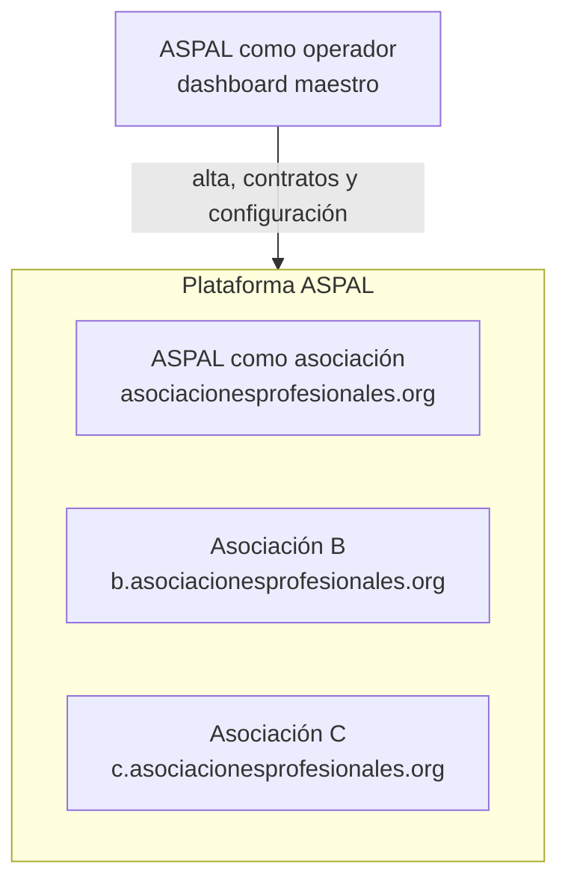

# Qué es la plataforma ASPAL

**Última revisión:** 15 de octubre de 2026

## En una frase

Una plataforma en línea, contratada como servicio (SaaS), con la que una
asociación profesional gestiona su sitio web, sus contenidos, sus miembros,
sus cobros y sus eventos desde un solo lugar.

## El problema que resuelve

Hoy una asociación profesional suele repartir su operación entre varias
herramientas que no se hablan entre sí: un WordPress para el sitio, un
complemento para membresías, hojas de cálculo para los miembros, otra
herramienta para los eventos y los cobros. Cada una tiene su propio acceso,
sus propios datos y su propio costo, y nadie tiene la foto completa.

La plataforma reúne todo eso en un sistema pensado específicamente para
asociaciones, en el que cada asociación activa solo lo que necesita.

## Para quién es

- **ASPAL**, su primer usuario. El sitio actual de ASPAL pasará a gestionarse
  desde la plataforma.
- **Otras asociaciones profesionales de Latinoamérica**, que contratarán la
  plataforma a ASPAL. ANPR es la candidata a siguiente piloto.

Dentro de cada asociación la usan su equipo directivo y administrativo, su
equipo editorial, sus miembros y el público que visita su sitio. Los detalles
están en [Roles y permisos](03-roles-y-permisos.md).

## Qué ofrece

La plataforma se organiza en **módulos**. Cada asociación contrata los que
necesita; por ejemplo, una puede usar solo eventos sin tener membresías.

| Módulo                   | Para qué sirve                                                                       | Etapa |
| ------------------------ | ------------------------------------------------------------------------------------ | ----- |
| Núcleo                   | Alta de asociaciones, cuentas y acceso, roles y permisos, aislamiento entre ellas    | 1     |
| Contenido y sitio web    | Blog, podcast y páginas del sitio, editables sin programar, con revisión y versiones | 2     |
| Membresías               | Planes, solicitudes, altas, renovaciones, miembros individuales e instituciones      | 3     |
| Cobros                   | Pagos en línea de membresías y eventos, devoluciones, comisiones y conciliación      | 4     |
| Comunidad y biblioteca   | Directorio, discusiones, grupos, moderación y biblioteca de recursos                 | 5     |
| Eventos                  | Agenda, venta de entradas, inscripciones, asistencia y constancias                   | 6     |
| Formación y ampliaciones | Cursos, evaluaciones y certificados; otras ampliaciones según demanda                | 7     |

La inteligencia artificial puede llegar después como ayuda (borradores,
búsqueda), nunca con capacidad para publicar o enviar por sí sola.

## Cómo está organizada

- **ASPAL tiene dos papeles distintos.** Como _operador_ vende la plataforma y
  administra los contratos desde el _dashboard maestro_. Como _asociación_ usa
  la plataforma igual que cualquier otro cliente. Ser operador no da acceso a
  los datos privados de las asociaciones.
- **Cada asociación tiene su propio espacio**: su sitio, su marca (logo y
  colores), sus contenidos, sus cuentas y sus miembros. Una asociación nunca ve
  los datos de otra; la base de datos lo impide, no solo la pantalla.
- **Cada asociación vive en su subdominio** del dominio de ASPAL. La excepción
  es ASPAL, la asociación principal, que se sirve en el dominio principal.
- **Cuentas independientes por asociación.** Quien participa en dos
  asociaciones tiene dos cuentas distintas, cada una con su contraseña, sus
  sesiones y sus roles, aunque use el mismo correo. Ser administrador en una no
  le da nada en la otra.
- **El personal de ASPAL que opera la plataforma tiene un acceso aparte**: no
  es miembro de ninguna asociación y entra solo al dashboard maestro.
- **Condiciones comerciales a la medida.** Cada asociación tiene su contrato:
  precio, moneda, periodo de prueba, comisión, módulos y límites.

## Qué no es (o todavía no)

- **No es un constructor libre de páginas** como Wix. Las páginas se editan
  con bloques aprobados que mantienen el diseño y la accesibilidad.
- **No sustituye todo WordPress de golpe.** Primero se migran el blog y el
  podcast. La comunidad, las membresías actuales (MemberPress) y los cursos
  siguen en WordPress hasta que llegue su módulo.
- **No migra el boletín.** Mailchimp sigue para captar suscriptores; un
  suscriptor no se convierte en miembro.
- **No incluye facturación electrónica (CFDI)** ni contabilidad avanzada en
  las primeras etapas.
- **No permite dominios propios** por asociación (por ejemplo,
  `miasociacion.org`) por ahora; es una ampliación candidata de la Etapa 7.

## Dónde estamos

| Etapa                        | Estado                                                                                                                                                                                                                                                                                                          |
| ---------------------------- | --------------------------------------------------------------------------------------------------------------------------------------------------------------------------------------------------------------------------------------------------------------------------------------------------------------- |
| 0 · Preparación y decisiones | ✅ Cerrada                                                                                                                                                                                                                                                                                                      |
| 1 · Núcleo y aislamiento     | 🔨 En curso. Hechos en local: corte 1 (esqueleto), corte 2 (asociaciones aisladas) y corte 3a (entrar, sesiones, roles y estado de las personas). En construcción: 3b (registro, recuperación e invitaciones por correo). Pendientes: 3c (Google), 4 (dashboard maestro) y 5 (estados del contrato y auditoría) |
| 2 · Gestor de contenido      | 📅 Primera entrega que se podrá usar                                                                                                                                                                                                                                                                            |
| 3 a 7                        | 📅 Planificadas                                                                                                                                                                                                                                                                                                 |

Todo se construye y prueba por ahora en un entorno local; la publicación en la
nube llegará más adelante. Todavía no hay ninguna función que un usuario final
pueda usar: lo construido hasta hoy son los cimientos (asociaciones aisladas
entre sí, cuentas, sesiones y roles) y funciona como servicio interno, todavía
sin pantallas.

**La primera demostración prevista:** un autor de ASPAL entra, edita una
página, la envía a revisión, otra persona autorizada la publica y la página
pública se actualiza. Después se repite con otra asociación sin que ninguna
vea nada de la otra.

## Para saber más

- Términos: [Glosario](02-glosario.md).
- Quién hace qué: [Roles y permisos](03-roles-y-permisos.md) y
  [Casos de uso](04-casos-de-uso/README.md).
- Plan completo: `docs/plan-plataforma-por-etapas.md`.
