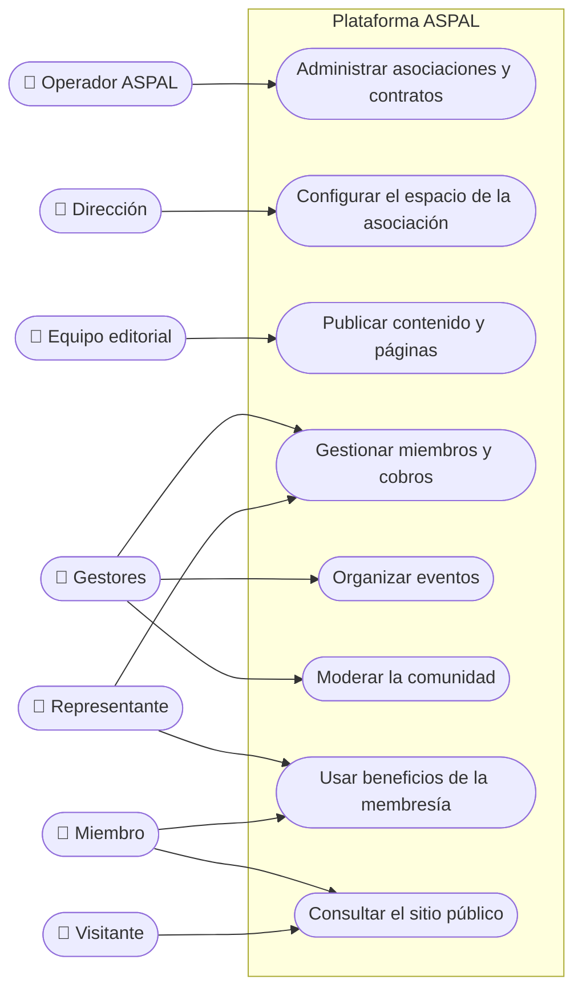

# Casos de uso por rol

**Última revisión:** 15 de octubre de 2026

Qué logra cada persona con la plataforma y en qué etapa llega. Un documento por
actor; los actores y sus roles están en [Roles y permisos](../03-roles-y-permisos.md).
Los estados siguen la [leyenda de la guía](../README.md#leyenda-de-estado).

| Actor                                                         | Lo esencial                                                   |
| ------------------------------------------------------------- | ------------------------------------------------------------- |
| [Operador ASPAL](operador.md)                                 | Vende la plataforma, da de alta asociaciones y presta soporte |
| [Dirección de la asociación](direccion-asociacion.md)         | Configura su espacio, su marca y su equipo                    |
| [Equipo editorial](equipo-editorial.md)                       | Escribe, revisa y publica el contenido del sitio              |
| [Gestores especializados](gestores.md)                        | Opera miembros, cobros, eventos y comunidad                   |
| [Representante institucional](representante-institucional.md) | Gestiona la membresía de su institución                       |
| [Miembro](miembro.md)                                         | Usa sus beneficios y gestiona sus datos                       |
| [Visitante](visitante.md)                                     | Conoce la asociación, se afilia o se inscribe                 |

## Vista general

## Cómo leer cada documento

- **El diagrama** muestra al actor y lo que puede lograr dentro de la
  plataforma, en lenguaje de negocio.
- **La tabla** detalla cada caso: qué logra, las reglas que importan, la etapa
  en que llega y su estado.
- Un caso de uso describe **un objetivo de la persona** («publicar un
  artículo»), no una pantalla ni un botón.
