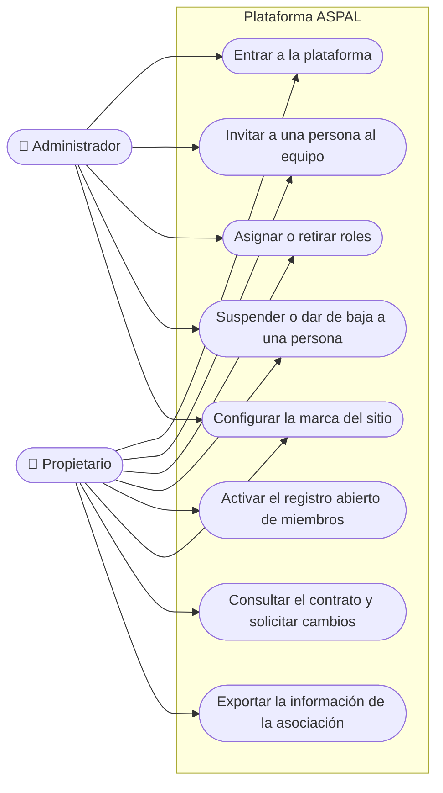

# Casos de uso · Dirección de la asociación

**Última revisión:** 15 de octubre de 2026

Quienes gobiernan el espacio de una asociación dentro de la plataforma.
Agrupa al **propietario** y a los **administradores**.

| Caso                                      | Qué logra                                              | Reglas que importan                                                                                                        | Etapa | Estado                                |
| ----------------------------------------- | ------------------------------------------------------ | -------------------------------------------------------------------------------------------------------------------------- | ----- | ------------------------------------- |
| Entrar a la plataforma                    | Acceder con correo y contraseña                        | La cuenta y la sesión valen solo en su asociación; las sesiones de administración caducan antes (2 h sin uso, 12 h máximo) | 1     | 🔨 Hecho en local (3a), sin pantallas |
| Entrar con enlace al correo o con Google  | Acceder sin contraseña                                 | El enlace es de un solo uso y solo vale en el navegador que lo pidió                                                       | 1     | 🔨 Corte 3b y 3c                      |
| Recuperar la contraseña                   | Volver a entrar si la olvidó                           | La respuesta es igual exista o no la cuenta, para no revelar quién está registrado                                         | 1     | 🔨 Corte 3b                           |
| Invitar a una persona al equipo           | Sumar a alguien con un rol de gestión                  | La invitación caduca; si quien invitó pierde su rol, sus invitaciones dejan de valer                                       | 1     | 🔨 Corte 3b                           |
| Asignar o retirar roles                   | Decidir quién hace qué en la asociación                | Nadie cambia sus propios roles; no se puede quitar al último administrador                                                 | 1     | 🔨 Hecho en local (3a), sin pantallas |
| Suspender o dar de baja a una persona     | Retirar el acceso a quien ya no debe tenerlo           | Cierra en ese momento todas sus sesiones; nadie cambia su propio estado                                                    | 1     | 🔨 Hecho en local (3a), sin pantallas |
| Activar el registro abierto de miembros   | Que cualquiera pueda crearse una cuenta de miembro     | Decisión de cada asociación; protegido contra cuentas basura                                                               | 1     | 🔨 Corte 3b                           |
| Configurar la marca del sitio             | Logo y colores propios en el sitio de la asociación    | Dentro de las opciones validadas, para no romper el diseño ni la accesibilidad                                             | 1     | 📅 Corte 4                            |
| Consultar el contrato y solicitar cambios | Saber qué tiene contratado y pedir ampliaciones        | La asociación no cambia por su cuenta su precio ni su comisión                                                             | 1     | 📅 Corte 4                            |
| Exportar la información de la asociación  | Tener una copia utilizable de su contenido y sus datos | Las exportaciones sensibles requieren permiso propio y quedan registradas                                                  | 2     | 📅                                    |

**Antes de producción** las cuentas de administración tendrán doble factor
obligatorio.

**Más adelante,** con cada módulo, la dirección también decide qué planes de
membresía ofrece, qué formularios usa y cómo se presentan sus eventos.
