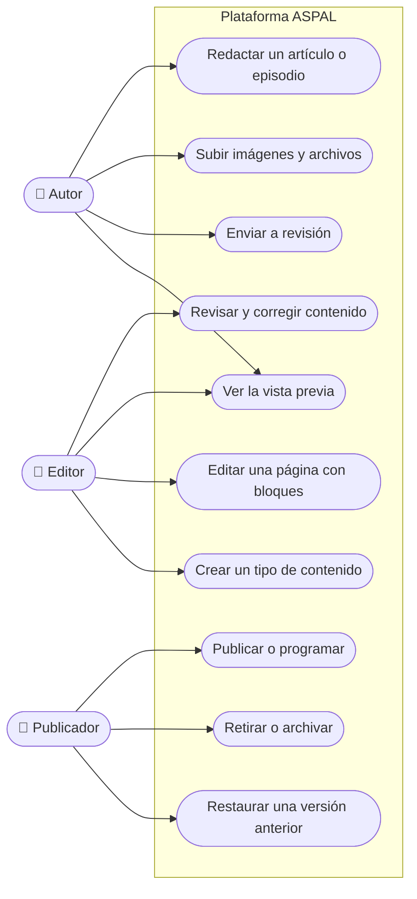
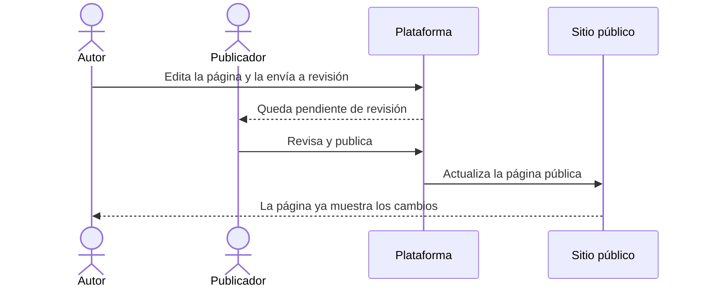

# Casos de uso · Equipo editorial

**Última revisión:** 15 de octubre de 2026

Quienes crean y publican el contenido del sitio de la asociación: blog,
podcast, páginas y recursos. Agrupa a **autor**, **editor** y **publicador**.
Es el núcleo de la primera entrega operativa (Etapa 2), que sustituye a
WordPress en el blog y el podcast.

| Caso                            | Qué logra                                                                  | Reglas que importan                                                                            | Etapa | Estado |
| ------------------------------- | -------------------------------------------------------------------------- | ---------------------------------------------------------------------------------------------- | ----- | ------ |
| Redactar un artículo o episodio | Preparar contenido con autor, fecha, categorías, etiquetas e imagen        | El autor solo edita sus propios borradores                                                     | 2     | 📅     |
| Subir imágenes y archivos       | Tener a mano los medios del contenido                                      | Textos alternativos para accesibilidad; los archivos se validan al subir                       | 2     | 📅     |
| Enviar a revisión               | Pasar el borrador a quien lo revisa                                        | Escribir no da permiso para publicar                                                           | 2     | 📅     |
| Revisar y corregir contenido    | Asegurar la calidad antes de publicar                                      | Si dos personas editan a la vez, nadie sobrescribe sin aviso el trabajo del otro               | 2     | 📅     |
| Ver la vista previa             | Ver cómo quedará antes de que sea público                                  | La vista previa nunca es visible para el público ni para buscadores                            | 2     | 📅     |
| Publicar o programar            | Hacer visible el contenido ahora o en una fecha                            | Solo con permiso de publicación; si la actualización del sitio falla, el panel lo muestra      | 2     | 📅     |
| Retirar o archivar              | Quitar del sitio un contenido                                              | No se pierde el historial                                                                      | 2     | 📅     |
| Restaurar una versión anterior  | Deshacer cambios                                                           | Restaurar crea una versión nueva; ninguna se borra                                             | 2     | 📅     |
| Editar una página con bloques   | Cambiar textos, imágenes y orden de bloques de las páginas institucionales | Solo bloques aprobados; un texto editable no puede alterar un proceso de pago o de inscripción | 2     | 📅     |
| Crear un tipo de contenido      | Publicar algo nuevo, como «recurso», sin programar                         | Los campos tienen tipo y validación; un tipo no reemplaza membresías, pagos ni cursos          | 2     | 📅     |

**La primera demostración** de la plataforma es justamente este recorrido: un
autor de ASPAL edita una página, la envía a revisión, otra persona autorizada
la publica y el sitio se actualiza.

