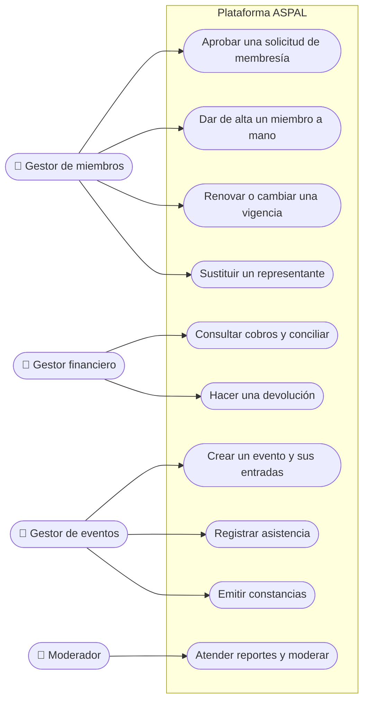

# Casos de uso · Gestores especializados

**Última revisión:** 15 de octubre de 2026

El personal de la asociación que opera un área concreta. Agrupa al **gestor
de miembros**, al **gestor financiero**, al **gestor de eventos** y al
**moderador**. Cada uno llega con su módulo, y ninguno obtiene por su rol las
facultades de los demás.

## Gestor de miembros · Etapa 3

| Caso                               | Qué logra                                            | Reglas que importan                                                                    | Estado |
| ---------------------------------- | ---------------------------------------------------- | -------------------------------------------------------------------------------------- | ------ |
| Aprobar una solicitud de membresía | Convertir a un solicitante en miembro                | Pagar, aprobar y estar vigente son cosas distintas                                     | 📅     |
| Dar de alta un miembro a mano      | Registrar miembros que no pasan por el pago en línea | Queda registrado el origen del alta                                                    | ❔     |
| Renovar o cambiar una vigencia     | Mantener al día las membresías                       | Cada cambio queda en el historial; las reglas de renovación y gracia están por definir | ❔     |
| Sustituir un representante         | Cambiar a quien representa a una institución         | Se conserva el historial del representante anterior                                    | 📅     |

## Gestor financiero · Etapa 4

| Caso                         | Qué logra                                         | Reglas que importan                                                                    | Estado |
| ---------------------------- | ------------------------------------------------- | -------------------------------------------------------------------------------------- | ------ |
| Consultar cobros y conciliar | Saber qué se cobró, qué comisión aplicó y el neto | Los cobros se reciben con Stripe Connect; ASPAL descuenta la comisión de cada contrato | 📅     |
| Hacer una devolución         | Reembolsar un pago                                | Requiere permiso propio; quién autoriza y su efecto en la membresía están por definir  | ❔     |

## Gestor de eventos · Etapa 6

| Caso                           | Qué logra                                      | Reglas que importan                                                   | Estado |
| ------------------------------ | ---------------------------------------------- | --------------------------------------------------------------------- | ------ |
| Crear un evento y sus entradas | Publicar un evento gratuito o de pago con cupo | No se vende más de lo disponible; puede haber descuento para miembros | 📅     |
| Registrar asistencia           | Validar entradas el día del evento             | El personal de acceso puede limitarse a validar entradas              | 📅     |
| Emitir constancias             | Acreditar la asistencia                        | Reglas de emisión y revocación por definir                            | ❔     |

## Moderador · Etapa 5

| Caso                       | Qué logra                                   | Reglas que importan                                          | Estado |
| -------------------------- | ------------------------------------------- | ------------------------------------------------------------ | ------ |
| Atender reportes y moderar | Mantener sana la comunidad de la asociación | Solo en los espacios asignados; no ve información financiera | 📅     |
