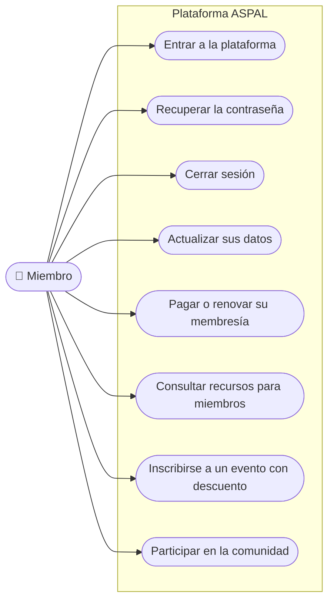

# Casos de uso · Miembro

**Última revisión:** 15 de octubre de 2026

La persona con una cuenta de miembro en una asociación (también llamada lector
cuando solo consulta contenido reservado). Si participa en dos asociaciones,
tiene una cuenta independiente en cada una.

| Caso                                  | Qué logra                                                          | Reglas que importan                                                                         | Etapa | Estado                                                                 |
| ------------------------------------- | ------------------------------------------------------------------ | ------------------------------------------------------------------------------------------- | ----- | ---------------------------------------------------------------------- |
| Entrar a la plataforma                | Acceder con correo y contraseña, con enlace al correo o con Google | Su cuenta vale solo en su asociación; la sesión caduca tras 8 h sin uso o 7 días            | 1     | 🔨 Contraseña hecha en local (3a); enlace (3b) y Google (3c) en camino |
| Recuperar la contraseña               | Volver a entrar si la olvidó                                       | Cambiar la contraseña cierra todas sus sesiones abiertas                                    | 1     | 🔨 Corte 3b                                                            |
| Cerrar sesión                         | Salir de forma segura                                              | Después, esa sesión ya no sirve                                                             | 1     | 🔨 Hecho en local (3a), sin pantallas                                  |
| Actualizar sus datos                  | Mantener al día su perfil                                          | Los datos públicos del perfil van aparte de los administrativos y financieros               | 3     | 📅                                                                     |
| Pagar o renovar su membresía          | Mantener su membresía vigente                                      | Reglas de pago, gracia y renovación por definir                                             | 3 y 4 | ❔                                                                     |
| Consultar recursos para miembros      | Usar la biblioteca y el contenido reservado                        | Solo lo que su membresía incluye                                                            | 3 y 5 | 📅                                                                     |
| Inscribirse a un evento con descuento | Aprovechar un beneficio de su membresía                            | El descuento se comprueba al inscribirse                                                    | 6     | 📅                                                                     |
| Participar en la comunidad            | Directorio, discusiones y grupos                                   | Al perder la membresía cambia su acceso, pero sus aportaciones no se borran automáticamente | 5     | 📅                                                                     |
