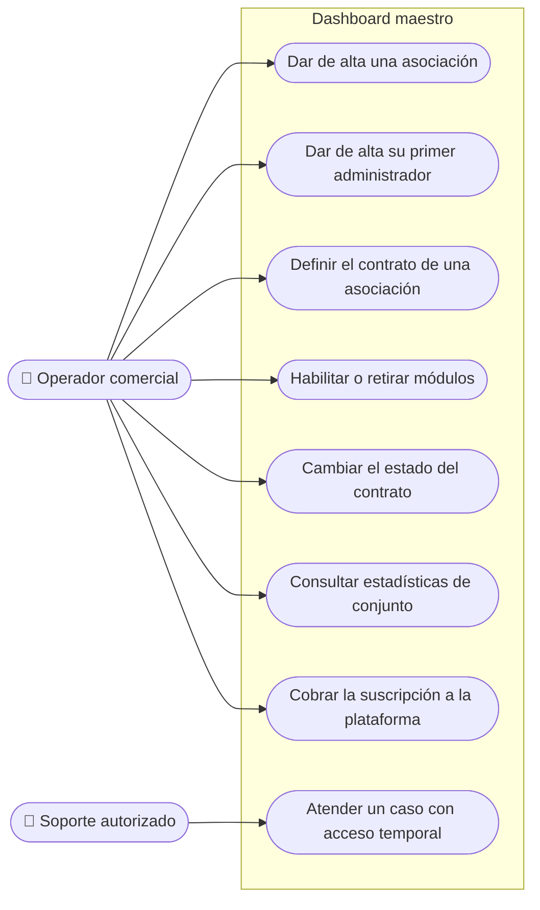

# Casos de uso · Operador ASPAL

**Última revisión:** 15 de octubre de 2026

ASPAL en su papel de dueña de la plataforma: la vende, la configura para cada
cliente y presta soporte. Agrupa al **operador comercial** y al **soporte
autorizado**. Trabajan desde el **dashboard maestro**, con un acceso propio:
no son miembros de ninguna asociación.

| Caso                                  | Qué logra                                                               | Reglas que importan                                                                   | Etapa | Estado     |
| ------------------------------------- | ----------------------------------------------------------------------- | ------------------------------------------------------------------------------------- | ----- | ---------- |
| Dar de alta una asociación            | Una nueva asociación tiene su espacio y su subdominio, sin tocar código | El subdominio es único; algunos están reservados (`www`, `api`, `admin`…)             | 1     | 📅 Corte 4 |
| Dar de alta su primer administrador   | La asociación tiene quien la gobierne desde el primer día               | A partir de ahí, la asociación invita a su propio equipo                              | 1     | 📅 Corte 4 |
| Definir el contrato de una asociación | Fijar precio, moneda, duración, prueba, comisión y límites              | Cada cambio crea una versión nueva; lo pactado antes no se altera                     | 1     | 📅 Corte 4 |
| Habilitar o retirar módulos           | La asociación usa solo lo contratado                                    | Retirar un módulo no borra sus datos                                                  | 1     | 📅 Corte 4 |
| Cambiar el estado del contrato        | Pasar entre prueba, activa, vencida y solo lectura                      | Solo lectura no detiene avisos de pago, conciliación ni auditoría                     | 1     | 📅 Corte 5 |
| Consultar estadísticas de conjunto    | Ver cómo va la plataforma en todas las asociaciones                     | Cifras agregadas; no da acceso al detalle privado de cada asociación                  | 1     | 📅 Corte 4 |
| Cobrar la suscripción a la plataforma | Las asociaciones pagan su contrato a ASPAL                              | Al principio se registra a mano, con trazabilidad; la automatización llega con cobros | 1 y 4 | 📅         |
| Atender un caso con acceso temporal   | Diagnosticar un problema de una asociación                              | Solo con autorización, con alcance y plazo acotados, revocable y registrado           | 1     | 📅 Corte 4 |

**Lo que el operador no hace:** ver o editar el contenido privado, los
miembros o los cobros de una asociación por el simple hecho de ser operador.
