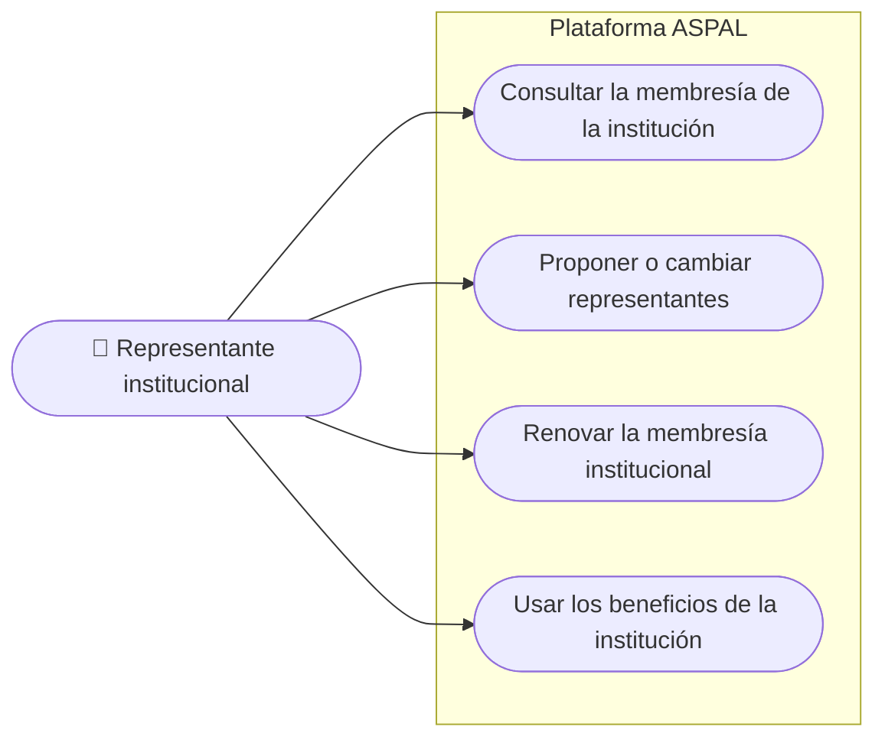

# Casos de uso · Representante institucional

**Última revisión:** 15 de octubre de 2026

La persona designada por una institución miembro (empresa, universidad,
dependencia) para actuar en su nombre ante la asociación. Una misma persona
puede ser a la vez representante y miembro individual.

| Caso                                     | Qué logra                                              | Reglas que importan                                                                         | Etapa | Estado |
| ---------------------------------------- | ------------------------------------------------------ | ------------------------------------------------------------------------------------------- | ----- | ------ |
| Consultar la membresía de la institución | Saber el plan, la vigencia y los representantes        | Solo de su institución y en esa asociación                                                  | 3     | 📅     |
| Proponer o cambiar representantes        | Mantener al día quién representa a la institución      | Si su relación lo permite; el número de representantes lo fija el plan; se guarda historial | 3     | ❔     |
| Renovar la membresía institucional       | Mantener vigente la membresía                          | Las reglas de renovación están por definir                                                  | 3 y 4 | ❔     |
| Usar los beneficios de la institución    | Acceder a recursos y descuentos del plan institucional | Los beneficios dependen del plan contratado                                                 | 3     | 📅     |
