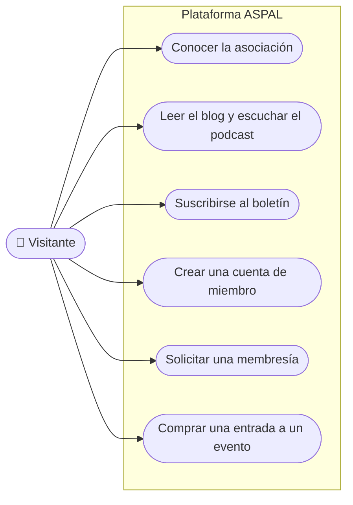

# Casos de uso · Visitante

**Última revisión:** 15 de octubre de 2026

Cualquier persona que llega al sitio de una asociación sin haber entrado con
una cuenta. Ve solo lo público.

| Caso                               | Qué logra                                    | Reglas que importan                                                                                                       | Etapa | Estado                         |
| ---------------------------------- | -------------------------------------------- | ------------------------------------------------------------------------------------------------------------------------- | ----- | ------------------------------ |
| Conocer la asociación              | Leer las páginas institucionales de su sitio | Cada asociación muestra su marca y su contenido; nunca el de otra                                                         | 2     | 📅                             |
| Leer el blog y escuchar el podcast | Consumir el contenido publicado              | Solo lo publicado; los borradores nunca llegan al público ni a buscadores                                                 | 2     | 📅                             |
| Suscribirse al boletín             | Recibir novedades por correo                 | Sigue en Mailchimp; suscribirse no lo convierte en miembro                                                                | —     | ✅ En el sitio actual de ASPAL |
| Crear una cuenta de miembro        | Tener acceso como miembro de la asociación   | Solo si la asociación activó el registro abierto; la cuenta existe cuando confirma el enlace enviado a su correo          | 1     | 🔨 Corte 3b                    |
| Solicitar una membresía            | Hacerse miembro de la asociación             | Pagar no equivale a ser aprobado; las restricciones de la membresía gratuita y las reglas de aprobación están por definir | 3 y 4 | ❔                             |
| Comprar una entrada a un evento    | Inscribirse a un evento sin ser miembro      | Se puede comprar sin membresía; el lugar se reserva por tiempo limitado mientras se paga                                  | 6     | 📅                             |

**Hoy** el visitante ya usa el sitio actual de ASPAL (blog, podcast, páginas
institucionales y boletín), alimentado por WordPress. La plataforma lo
sustituirá sin que el visitante note la diferencia.
